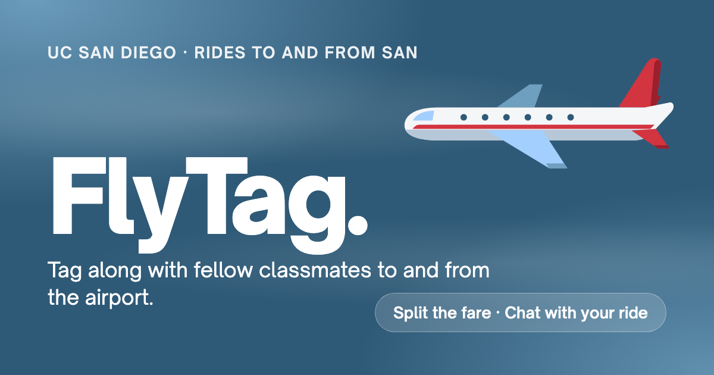
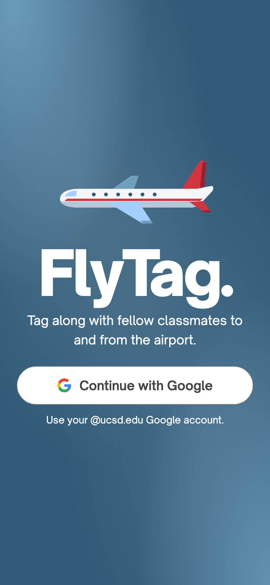
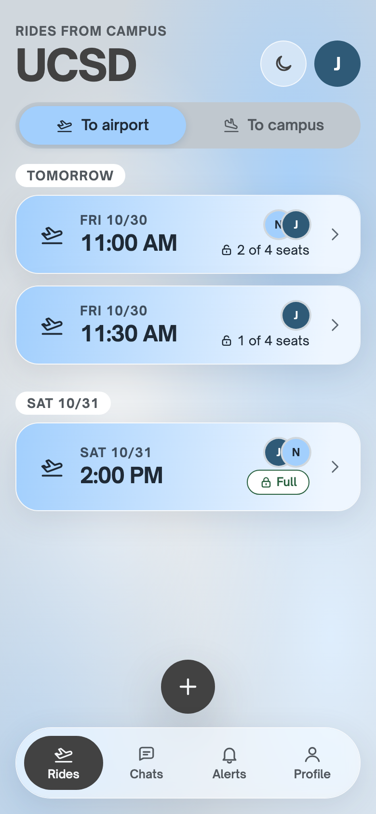
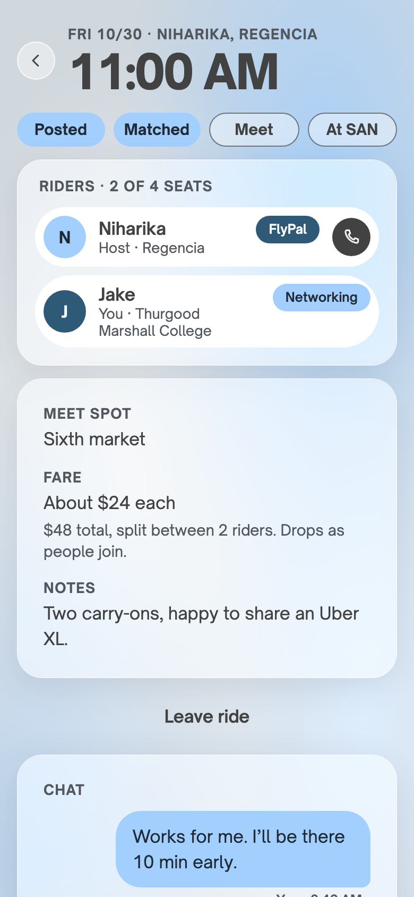
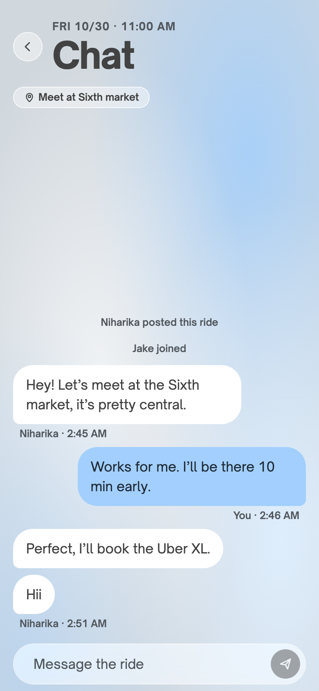
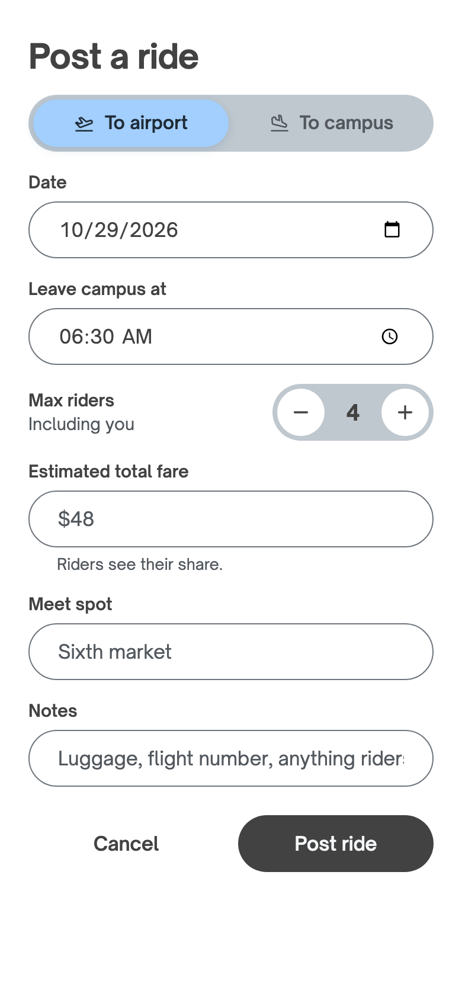
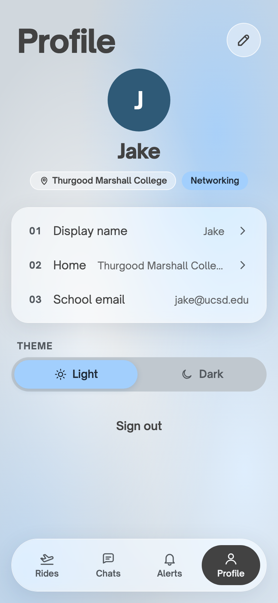
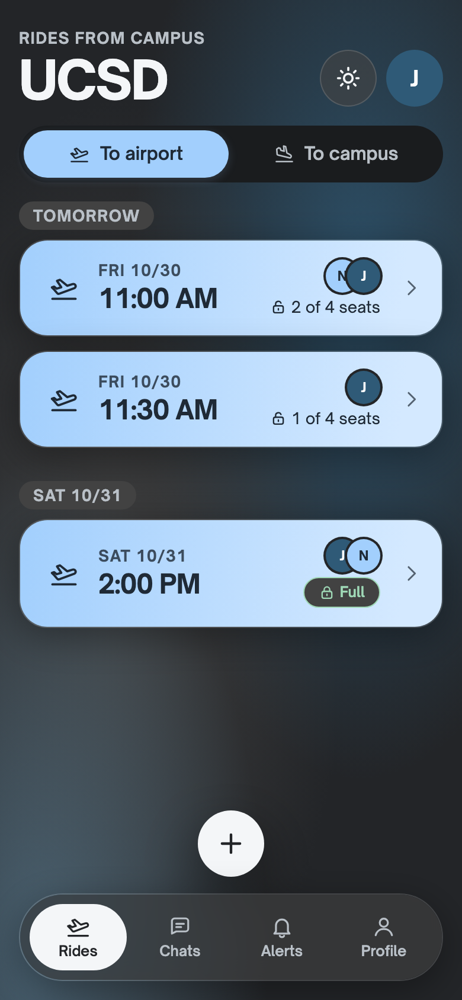
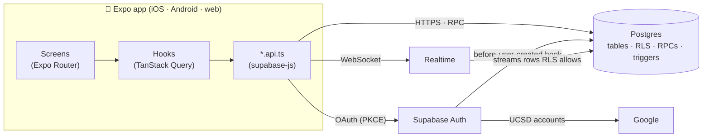

<div align="center">



# FlyTag ✈️

**Rides to and from San Diego airport, shared with fellow UCSD students.**

Expo · React Native · TypeScript · Supabase · iOS, Android & web

</div>

---

## 👋 The problem

Every break, thousands of UC San Diego students make the same trip to **SAN airport**, often at the same hour and from the same few colleges. Most go alone: a $40–$60 rideshare each way, or a shuttle schedule that rarely fits a flight. Coordinating in group chats works until it doesn't: posts get buried, seats get double-booked, and phone numbers end up shared with strangers.

## 💡 The idea

FlyTag is a small, focused app for one job: **find classmates heading to (or from) the airport at your time, and ride together.**

- 🎓 **UCSD only.** Every account is a verified `@ucsd.edu` Google account, checked on the server.
- 🪑 **Seats that add up.** A 4-seat ride never gets a 5th rider, even when two people tap *Join* at once.
- 💸 **Split the fare.** Riders see "About $24 each", and the share drops as people join.
- 💬 **Talk it through.** Each ride has a live chat for the meet spot and last-minute changes.
- 🔒 **Private by default.** Phone numbers reach co-riders only, and only if the rider chooses to share.

## 📱 A quick tour

<table>
  <tr>
    <td align="center"><br /><sub><b>Welcome</b><br />The plane glides in once; sign in with your UCSD Google account.</sub></td>
    <td align="center"><br /><sub><b>Rides</b><br />Upcoming rides by day. Open lock = seats left, closed = full.</sub></td>
    <td align="center"><br /><sub><b>Ride detail</b><br />Timeline, riders, meet spot and the per-person fare.</sub></td>
  </tr>
  <tr>
    <td align="center"><br /><sub><b>Chat</b><br />Live messages, with the meet spot pinned on top.</sub></td>
    <td align="center"><br /><sub><b>Post a ride</b><br />Suggests nearby rides to join before you post a duplicate.</sub></td>
    <td align="center"><br /><sub><b>Profile</b><br />Home college or neighbourhood, a rider tag, photo and theme.</sub></td>
  </tr>
</table>

<p align="center"><br /><sub>Two themes from one set of design tokens: <b>Mist</b> (above) and <b>Charcoal</b>.</sub></p>

## 🎨 Design

FlyTag has its own small brand system, built first as a design artifact, then ported to native components.

- **One set of tokens.** Colours, type, spacing and radii live in [`docs/design/tokens.json`](docs/design/tokens.json). A script generates the TypeScript and CSS from it, so a colour change is one edit.
- **A calm, cool palette:** mist, sky and charcoal, with frosted glass panels and pill-shaped controls. The cherry-red *flare* appears in one place only, the plane.
- **30 interface components** in [`src/ui/`](src/ui/), each shown with all its variants in a development-only gallery (`/dev/ui`).
- **Accessibility built in:** 48 pt touch targets, labels and roles on every control, status never shown by colour alone, and the plane's animation respects Reduce Motion.

## 🧠 How it works



Every screen follows the same path: **screen → hook → api → Supabase**. The rules live in the database, so they hold even if someone skips the app and calls the API directly:

| Rule | Where it's enforced |
|---|---|
| Only `@ucsd.edu` accounts can sign up | A Postgres `before-user-created` auth hook |
| Who can read and write each table | Row Level Security policies on every table |
| The last seat goes to exactly one person | `join_ride()` locks the ride row (`select … for update`) |
| A ride always has exactly one host | `leave_ride()` hands over to the earliest rider, or cancels an empty ride |
| Phone numbers only reach co-riders who share | `get_rider_contact()`, the only function that returns one |
| Chat is members-only, live too | RLS on `messages`; Realtime only streams rows a subscriber may read |
| No spam bursts | A trigger rejects more than 20 messages a minute |

**A highlight: the last-seat race.** [`npm run db:race`](scripts/race-test.ts) sends 10 simultaneous *Join* requests at a ride with one seat left. With the row lock, exactly one succeeds and nine get "This ride just filled up." With the lock removed, as an experiment, all ten got in: **11 people in a 2-seat ride.** CI runs this test on every push.

## 🛠️ Technical specs

| Area | Choice |
|---|---|
| **App** | Expo SDK 58 · React Native 0.88 · React 19 · TypeScript 6 (strict) |
| **Navigation** | Expo Router (file-based), `Stack.Protected` route guards |
| **Styling** | NativeWind 4 (Tailwind) driven by generated design tokens; Reanimated 4 for motion |
| **Data** | TanStack Query 5 (server state, optimistic updates) · Zustand 5 (UI state only) |
| **Forms** | react-hook-form + zod |
| **Dates** | date-fns-tz, always shown in San Diego time |
| **Backend** | Supabase: Postgres 17, Row Level Security, RPCs, triggers, Realtime, Storage |
| **Auth** | Sign in with Google (UCSD accounts), PKCE flow; email codes in development |
| **Hosting** | Vercel (web), deployed automatically from `master` |
| **Quality** | Jest + React Native Testing Library · pgTAP · GitHub Actions CI |

**By the numbers:** 20 database migrations · 129 database tests · 72 app tests · the last-seat race test.

## ✅ Quality

- **Database tests (pgTAP):** every policy has an *allowed* and a *denied* case, and every RPC error code is covered. They run against a fresh database built from the migrations.
- **App tests (Jest):** form rules, date and timeline logic, error messages, a render of every UI component, and the sign-in route guards.
- **CI:** on every push, GitHub Actions checks that the generated tokens and icons are up to date, runs typecheck, lint and the app tests, starts a fresh Supabase, and runs the database and race tests.

## 🚀 Run it locally

You'll need Node 24, Docker and the Expo Go app on your phone.

```bash
npm install
cp .env.example .env        # then add your Mac's Wi-Fi IP and the key `npm run db:start` prints
npm run db:start            # local Supabase in Docker, with demo rides and two demo riders
npx expo start              # scan the QR code with Expo Go
```

Development builds sign in with an email code. Codes land in the local test inbox at `http://127.0.0.1:54324`. Try `jake@ucsd.edu` or `niharika@ucsd.edu`.

| Command | What it does |
|---|---|
| `npm run typecheck` · `npm run lint` · `npm test` | The app checks CI runs |
| `npm run db:test` · `npm run db:race` | Database tests and the last-seat race test |
| `npm run db:types` | Regenerate TypeScript types after a migration |
| `npm run tokens` · `npm run icons` | Regenerate theme and icon code from their sources |
| `npm run og-image` | Re-render the link-preview card |

## 🗂️ Project structure

```
src/
  app/          routes only: thin files that compose features
  features/     auth · profile · rides · chat (api, hooks, schemas, logic, screens)
  ui/           presentational design-system components
  theme/        generated tokens, theme hooks
  lib/          Supabase client, dates, error messages
supabase/
  migrations/   one concept per file, commented
  tests/        pgTAP tests, read like a spec
docs/
  spec/         the product and technical spec
  decisions/    short records of key decisions and why
```

## 🧭 Status and roadmap

FlyTag is in **web beta** for UCSD students.

- [x] Design system, sign-in, onboarding and editable profiles
- [x] Browse and post rides, with merge suggestions
- [x] Join, leave, host handoff and the fare split
- [x] Live ride chat
- [x] Web version, Sign in with Google, link previews
- [ ] Alerts and push notifications
- [ ] Safety: block, report and delete account
- [ ] Privacy policy and a wider beta
- [ ] App Store and Google Play

## 💜 About

Designed and built by **Niharika Sapre** at UC San Diego. The spec in [`docs/spec/`](docs/spec/) and the decision records in [`docs/decisions/`](docs/decisions/) tell the full story of how FlyTag came together.
