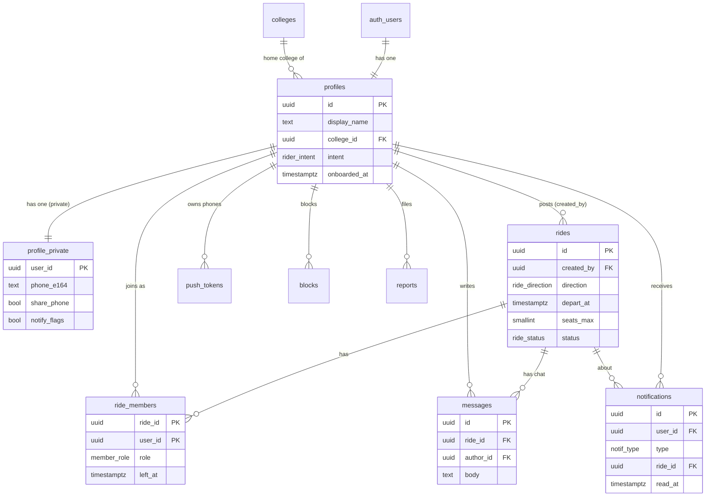

# FlyTag database map

> Keep this file updated in the same PR as every migration. Full column details: `docs/spec/05-database.md` §6.
>
> **Built so far (Phase 2):** `colleges`, `profiles`, `profile_private`, the signup hook and the new-user trigger. Everything else on this page is the plan.

| Migration | Adds |
|---|---|
| `20261029000001_colleges.sql` | `colleges` + the 9 rows (8 colleges + Graduate student) |
| `20261029000002_profiles.sql` | `rider_intent` enum, `profiles`, `profile_private`, `set_updated_at()`, `on_auth_user_created` trigger |
| `20261029000003_auth_hook.sql` | `hook_restrict_signup_to_ucsd` (enabled in `supabase/config.toml`) |

## 1. The diagram

**The one-sentence version:** a *profile* posts or joins *rides* through *ride_members*; each ride has *messages*; things that happen create *notifications*, which get pushed to *push_tokens*. Everything private sits in *profile_private*; safety lives in *blocks* and *reports*.

## 2. Life of a ride (follow the rows)

| Step | User does | App calls | Rows that change |
|---|---|---|---|
| 1 | Niharika signs up | Supabase Auth OTP | hook checks `@ucsd.edu` → `auth.users` + trigger creates `profiles`, `profile_private` |
| 2 | Finishes onboarding | `update profiles` | `profiles.college_id`, `intent`, `onboarded_at` |
| 3 | Posts Tue 3/18 · 11:00 AM, 4 seats | `create_ride` | `rides` +1, `ride_members` +1 (host), `messages` +1 (system) |
| 4 | Jake joins | `join_ride` | locks ride row → `ride_members` +1, `messages` +1 (system) → trigger: `notifications` +1 for Niharika |
| 5 | Notification is sent | (automatic) | webhook → `push` function reads `push_tokens` → Expo → Niharika's phone |
| 6 | Jake: "Meet at Sixth market?" | `insert messages` | `messages` +1 → realtime to Niharika's open chat → trigger: `notifications` (collapsed) |
| 7 | 2 hours before | (pg_cron) | `notifications` +1 per member (`ride_reminder`) |
| 8 | Ride time passes | nothing | no row changes: the app treats `depart_at < now() − 15 min` as past |

## 3. Automatic behaviour (things the database does without the app asking)

Each item lives in the migration named next to it. If something "magically" happens, it's on this list.

| Trigger | What happens | Migration |
|---|---|---|
| New `auth.users` row | create `profiles` + `profile_private` (name from sign-in, else email prefix) | `20261029000002_profiles.sql` |
| Signup attempt | `before-user-created` hook rejects non-UCSD emails | `20261029000003_auth_hook.sql` |
| Any `profiles` update | `updated_at` stamped | `20261029000002_profiles.sql` |
| `ride_members` insert | notify other members (`rider_joined`) | `*_notifications.sql` |
| `messages` insert | notify other members (`new_message`, max 1 unread per 10 min) | `*_notifications.sql` |
| `update_ride` / `cancel_ride` | notify members | `*_notifications.sql` |
| `notifications` insert | DB webhook → `push` Edge Function | dashboard + `functions/push` |
| Every 5 min (pg_cron) | create `ride_reminder` notifications | `*_reminders.sql` |
| `messages` insert | rate limit: reject if > 20 in the last minute from that user | `*_messages.sql` |

## 4. Who can see what (RLS in one table)

| You can read… | …if |
|---|---|
| any profile | you're signed in and neither of you blocked the other (block check arrives with `blocks` in Phase 7) |
| your own `profile_private` | always (nobody else, ever) |
| colleges | you're signed in |

**Who can write what (so far):** your own `profiles` row, only `display_name`, `college_id`, `intent`, `avatar_path`, `onboarded_at` (column grants); your own `profile_private` settings. Rows themselves are only created by the trigger. `colleges` changes only via migrations.
| a ride and its members | you're signed in and haven't blocked the host |
| a ride's messages | you're a current member of that ride |
| someone's phone number | you're both current members of the same ride **and** they turned on sharing (via `get_rider_contact` only) |
| notifications, push tokens, blocks | they're yours |
| reports | never (reviewed in the Supabase dashboard) |
